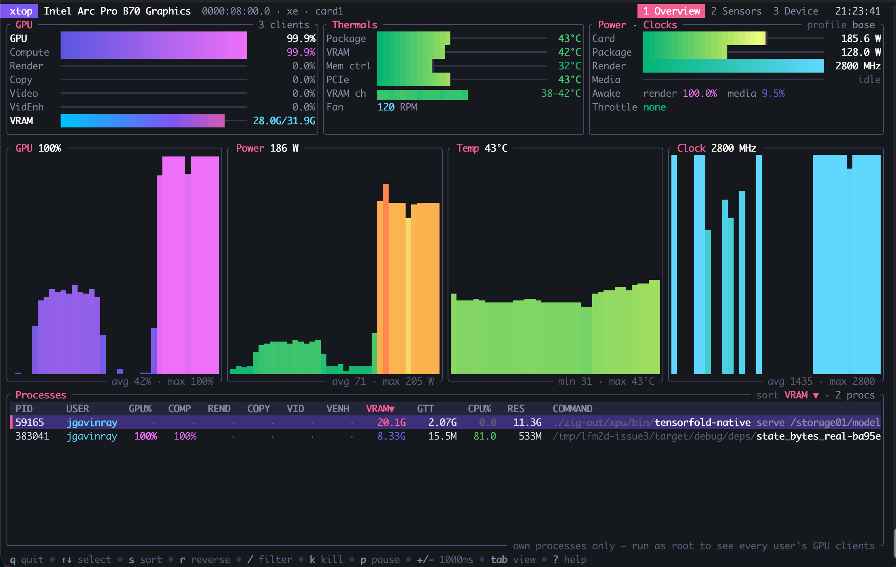

# xtop

[](https://github.com/jgavinray/xtop/actions/workflows/ci.yml)
[](LICENSE)

An htop-style terminal monitor for Intel GPUs: Arc, Arc Pro, Battlemage and
Alchemist on the `xe` driver, with basic `i915` support.

It shows real-time engine utilization, VRAM, temperatures (including every VRAM
channel), fan, board and package power, clocks, throttle reasons, and a
per-process table you can sort, filter and signal. xtop is a single binary
with no runtime dependencies. It reads the kernel interfaces directly, so you
don't need xpu-smi, Level Zero or root.



## Install

**Homebrew** (Linux):

```sh
brew install jgavinray/tap/xtop
```

**Prebuilt binary**: each [release](https://github.com/jgavinray/xtop/releases)
ships a statically linked x86_64 build. Download it, extract it, and put `xtop`
on your `PATH`.

**From source** (Rust 1.88+):

```sh
cargo install --git https://github.com/jgavinray/xtop
```

For a fully static binary like the release builds:

```sh
RUSTFLAGS="-C target-feature=+crt-static" \
  cargo build --release --target x86_64-unknown-linux-gnu
```

## Usage

```
xtop [-i MS] [-d ID|BDF] [-l] [-s]
  -i, --interval   refresh interval in ms (default 1000)
  -d, --device     start on a GPU (index from --list, or PCI address)
  -l, --list       list GPUs
  -s, --snapshot   print one plain-text sample and exit (scriptable)
```

The views are **Overview** (gauges, history graphs, processes), **Sensors**
(every sensor with limits, clocks, throttle flags, VRAM channel grid and
temperature history) and **Device** (topology, firmware, PCIe link, power
limits, data sources).

| Key | Action |
|---|---|
| `↑ ↓ PgUp PgDn Home End` | select process |
| `tab` / `1 2 3` | Overview · Sensors · Device |
| `s` `<` `>` / `r` | change sort column / reverse |
| `g` `m` `c` | sort by GPU% / VRAM / CPU% |
| `/` | filter processes (`esc` clears) |
| `k` / `K` | SIGTERM / SIGKILL selected process (asks first) |
| `p` | pause |
| `+` `-` | refresh interval |
| `d` `[` `]` | switch GPU |
| `?` | help |

## Where the numbers come from

| Data | Source |
|---|---|
| Temperatures (package, VRAM, memory controller, PCIe, per-channel VRAM), fan | hwmon (`/sys/class/drm/cardN/device/hwmon`) |
| Board / package power | Δ of hwmon `energyN_input` (µJ) |
| Power limits | hwmon `power1_cap` (PL2), `power1_crit` |
| Clocks, throttle reasons, power profile | `tileN/gtN/freq0/*` |
| GT "awake" % | Δ `gtidle/idle_residency_ms` (time out of C6) |
| VRAM used/total, CPU-visible BAR | `DRM_IOCTL_XE_DEVICE_QUERY` (mem regions) on the render node |
| Xe-cores, EUs, engines, GuC/HuC, IP version | same ioctl (topology, engines, GT list, uC fw) |
| Per-process engine %, VRAM, GTT | DRM fdinfo: `drm-cycles-*` / `drm-total-cycles-*` ÷ capacity |
| PCIe link | PCI sysfs on the card's switch upstream port, capped by the slot's port |

## Caveats

- Without root, fdinfo only shows **your own** processes. Run as root to see
  every user's GPU clients. Device-wide VRAM, power, temperatures and clocks
  need no root.
- GPU% is the busiest engine class summed over visible clients. nvtop, qmassa
  and xpu-smi 2.x use the same definition.
- Reading fdinfo or hwmon briefly wakes the GPU, so "awake" slightly
  over-reports at idle.
- Not used: the xe PMU, which keeps the GT out of C6 while it's open and needs
  CAP_PERFMON, and PMT telemetry, which is root-only.

## Contributing

See [CONTRIBUTING.md](CONTRIBUTING.md). Bug reports that include
`xtop --list` and `xtop --snapshot` output are the most useful.

## License

Copyright (C) 2026 J. Gavin Ray

This program is free software; you can redistribute it and/or modify it under
the terms of the GNU General Public License version 2 as published by the Free
Software Foundation. See [LICENSE](LICENSE) for the full text.
